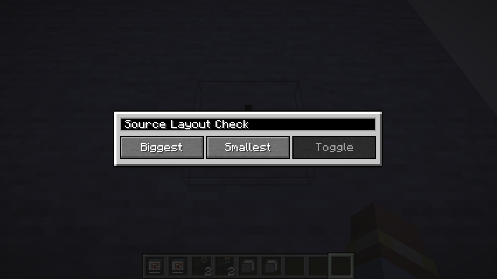
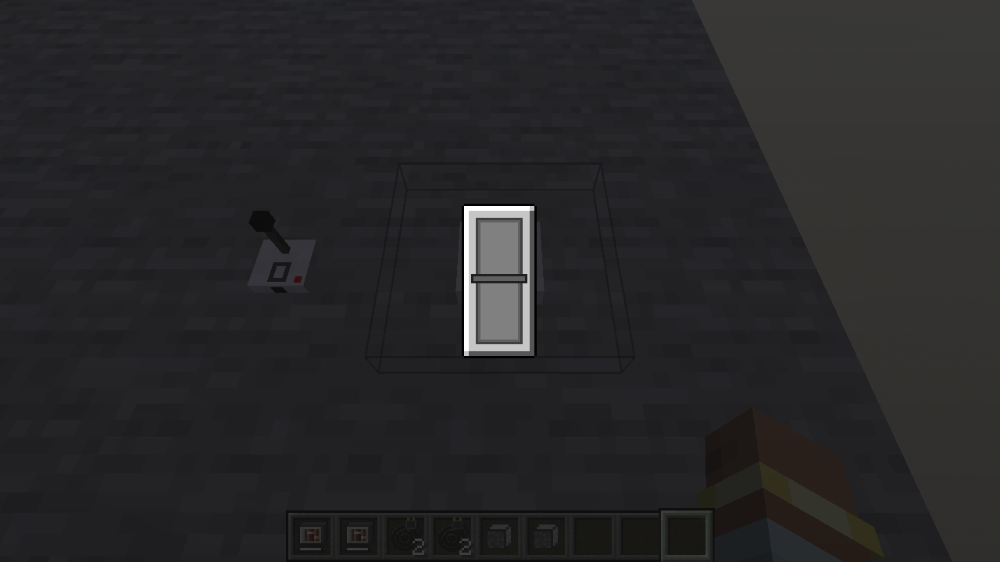
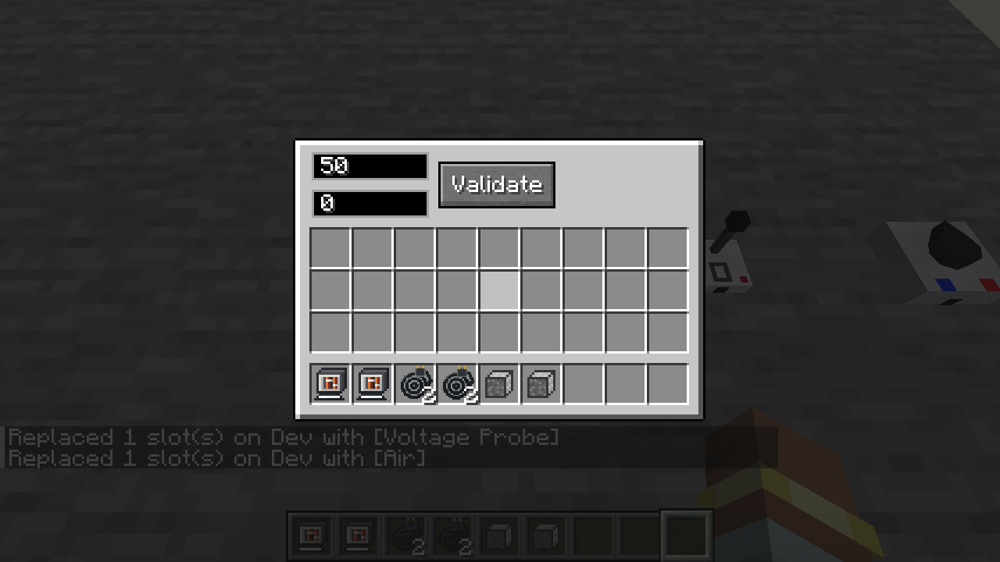

# Source GUI matching, first batch

Reference: ForkPatch 3.0.77 commit `b7444a7b8a0c5e072b1fd35eed2b74a282c3348c`.
This work starts at `4c52e843d62b25ce77d19308c61bfb67ccd08169`, confirmed as
PR #1's current head before publishing. The initial working tree was clean.

The following 13 layout variants now use the source's fixed panel dimensions,
control rectangles and player inventory origins, rather than expanded adaptive
rows. Each JSON records the source revision and original GUI file.

| Layout | Source panel | Matched controls |
| --- | --- | --- |
| Wireless transmitter / source | 232 × 24 | Channel field |
| Wireless receiver | 232 × 49 | Channel and three aggregator buttons |
| Relay / alarm | 128 × 32 | Single switch/mute button |
| Timer | 62 × 72 | Reset, Set and timeout field |
| Signal trimmer | 32 × 66 | Vertical track and cursor |
| Digital watch | 176 × 114 | Battery and player slots |
| Breaker | 176 × 140 | Voltage fields, switch, player inventory |
| Electrical probe | 176 × 166 | Measurement modes, direction, range and Validate |
| Voltage probe | 176 × 121 | Range, Validate and player inventory |
| Thermal probe | 176 × 166 | Power/temperature modes, range and Validate |
| Temperature probe | 176 × 166 | Range, Validate and player inventory |

Text fields use the source's 12-pixel height and white text. The receiver's
selected mode is disabled as in the source; its connection state appears in the
channel tooltip. The alarm uses the original mute labels. Added native titles,
inventory captions and redundant field labels are omitted from these source
layouts. The trimmer restores the source's vertical grayscale track and cursor,
with maximum at the top, while preserving bounded values, mouse-release commits,
keyboard control and server synchronization.

Server menus, slot order, filters, simulation and packet formats are unchanged.
The breaker and temperature probe retain native cable slots absent from their
source GUI. Native field length bounds remain intact. Vanilla 26.3 buttons,
font/tooltips and slot skins may differ from 1.21.1; these are coordinate matches,
not a claim of pixel-identical rendering across both engines.

Validation:

- `:build :cad:test`: 685 root tests selected, **682 passed**, three existing
  optional previews skipped; all **15 CAD tests** passed. Added layout tests
  exercise fixed dimensions independent of font metrics, malformed/duplicate
  rectangles and bounds. Every shipped layout still passes the overlap check.
- Actual 1280 × 720 software-OpenGL client at automatic GUI scale: receiver
  channel editing and direct mode selection, compact panel rendering and the
  vertical trimmer mouse/keyboard movement and compact voltage-probe inventory
  inspected. Screenshots below are from the 26.3 client;
  a running 1.21.1 side-by-side image comparison has not been performed.
- A final targeted `LayoutTest` run passes all 10 tests after source-reference
  metadata was added. The full build above includes the same two new tests.
- The repeat unfiltered native run ended with SIGTERM (exit 143) before producing
  its XML report; it is incomplete and is not counted as a passing native suite.
  Its 473 golden failed-assertion lines are byte-identical after log-prefix
  removal to the previous completed run in `rated-lamp-supplies-validation.json`.
  The previous completed native baseline remains 1,222/1,224, with only the two
  historical goldens failing. Server menu and simulation code are unchanged.
- No golden references, existing tests, tolerances, skips or Gradle pins changed.

Remaining visual work includes the larger UPS, outlet, manufacturing, lamp-supply,
off-grid and industrial screens and other inherited classic panels. Some expose
native features that the source GUI does not have (independent unplug buttons,
48 live rack slots and installed-cable range); matching must preserve access to
those controls. Tall source panels also need review at small window sizes.
Portable carry and additional adapters remain unfinished, independently of this
visual pass. Hardware GPU rendering, multiplayer and universal resource-pack
parity remain unverified.
