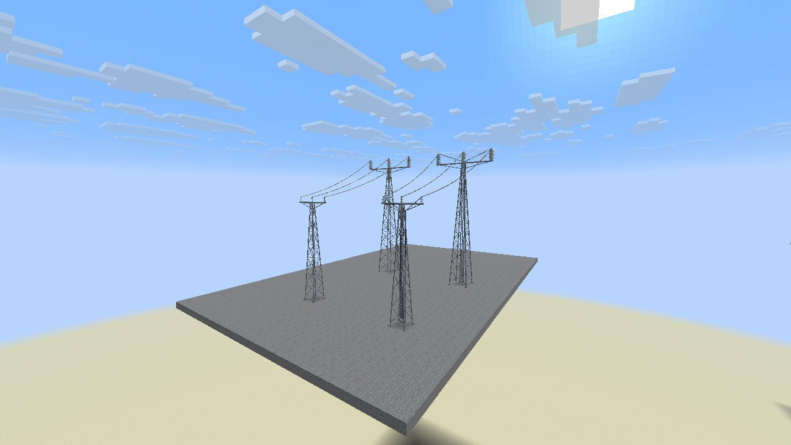
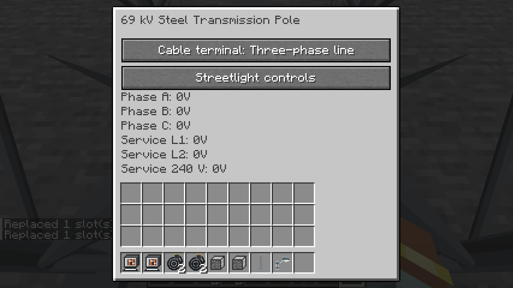
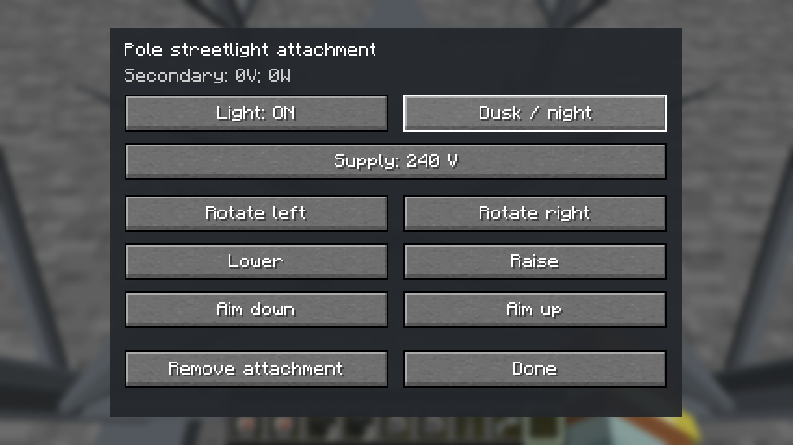
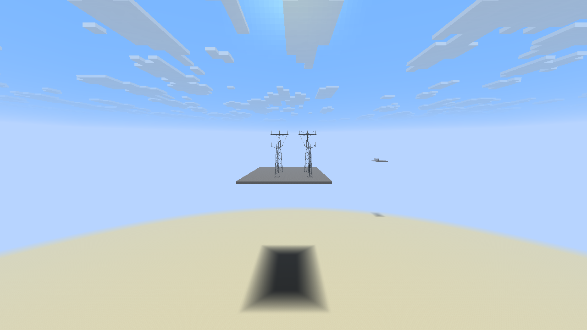
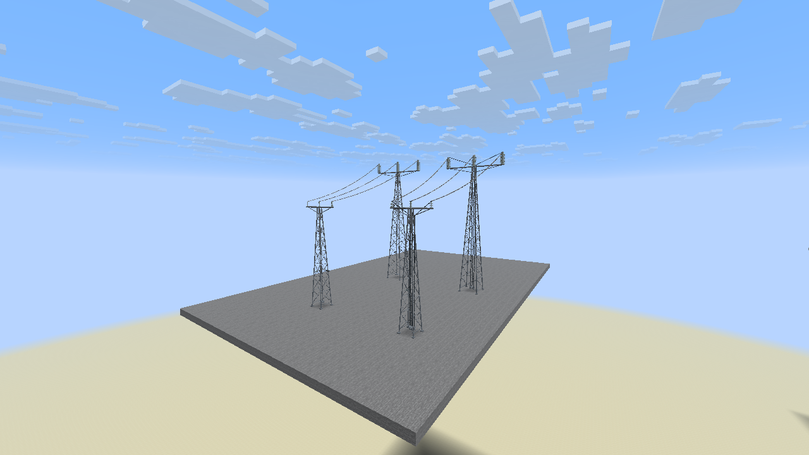
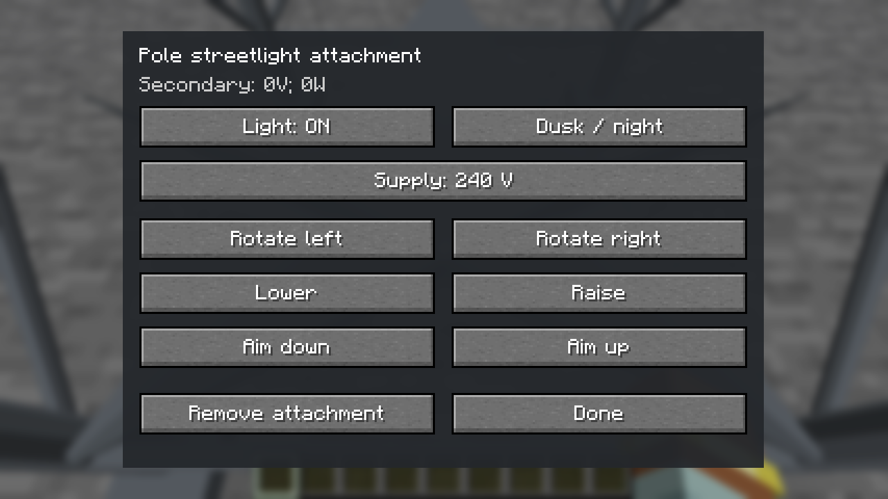

# Steel transmission poles and cable risers

Continuation from `bbbe15a170615b5438bdf8c35c75c0d41d86e090` on PR #1.
Reference: ForkPatch 3.0.77 `b7444a7b8a0c5e072b1fd35eed2b74a282c3348c`.
The initial worktree was clean and the remote branch had no newer commits.

## Devices

| Native/source lookup | Device | Height | Maximum span |
| --- | --- | --- | --- |
| 8014 | 69 kV Steel Transmission Pole | 16 blocks | 128 blocks |
| 8015 | 230 kV Steel Transmission Tower | 24 blocks | 192 blocks |
| 8020 | 69 kV Three Phase Cable Riser Pole | 16 blocks | 128 blocks |
| 8021 | 230 kV Three Phase Cable Riser Tower | 24 blocks | 192 blocks |

These are passive poles, with three independent primary circuits and a separate
120/240 V service rack. They do not generate power or transform primary voltage
into secondary service. The rack uses the destination's existing L1, L2 and
240 V circuit equivalents. Existing native identities retain their exact values.

The four original steel OBJ models, materials and catalog icons are copied from
the pinned source. The source's separate suspension/lead parts and optional
streetlight are rendered alongside them. Primary crossarms align to the actual
primary spans; secondary branches and riser base entries retain the placement
front. Alignment runs on topology changes, not on simulation ticks. Status
publications reuse unchanged native catenary meshes.

Placement reserves the whole swept crossarm area before creating the pole:
7 × 7 across the upper three levels for the 69 kV models, and 11 × 11 for the
230 kV models, plus the central height. This is a conservative native adaptation
of the source's narrower initial reservation, needed for rotating crossarms.
Linking cannot rotate a crossarm into an unreserved neighboring block. An
obstruction rejects placement transactionally. Existing intermediate development
fixtures were replaced before the final client exhibit.

The new renderers provide tall/span bounding boxes and a bounded extended owner
view distance (144/216 blocks). Other transparent-node renderers retain vanilla's
view-distance behavior. The owner chunk must still be loaded; this is not the
source's separate distant-model streaming system.

## Wiring and construction

Open the native pole menu to select:

- **Three-phase line (52)**, or individual primary **A/B/C (32–34)**.
- **Service bundle (50)**, or **L1/L2/240 V (40–42)**.

Use an intact bare overhead conductor on primary terminals. Service links require
insulated cable under the existing native policy. Each bundled scalar span pays
all three core lengths; multicore cable retains the existing jacket-length rule.
Payment, thermal state, native saves, canonical shared link records and exact
one-time refunds use the established grid implementation. Span lengths/ranges
follow its existing owner-to-owner game-distance convention.

Cable risers additionally expose primary A at the left base, B at the right base,
and C at the rear, all at the floor-cable entry. Their bottom service entries stay
separate. Actual placed-cable circuits are checked in all four orientations.

Source recipes are retained:

- 69 kV pole: a Three Phase Utility Pole and six Iron Bars in the source pattern.
- 230 kV tower: three 69 kV poles, four Iron Blocks and one Iron Bars item.
- Each riser: its corresponding steel pole plus three Copper Cables.

## Removable streetlight

Right-click the pole with a **Pole Streetlight Attachment** to install one paid
70 W fixture. Repeating the installation cannot consume another item. Open the
pole menu with an empty hand, then select **Streetlight controls**. The inventory
menu closes normally before the standalone attachment screen opens.

The attachment screen uses the source's 308 × 210 layout, colors, button positions
and 15-degree yaw / 5-degree pitch controls. Select automatic 120/240 V supply or
pin a service voltage, choose manual/dusk operation, and adjust height and aim.
The fixture draws through one real secondary resistor and cannot feed from the
primary. Real emitted light follows the same aim transform and only touches
resident chunks. Removing or breaking the fixture refunds it once; the carried
pole does not contain a second installed attachment. Owner saves retain paid
installation and settings. Invalid or truncated controls leave valid state intact.

The main pole screen uses the source's 240 × 230 panel, terminal selector and
player inventory origin, with separate primary/service measurements and a button
for the native attachment screen. Vanilla 26.3 widget/font rendering can differ
from 1.21.1; these are source-based designs, not a claim of pixel identity.

## Validation

Final counts, exact golden delta and client evidence are recorded in
[power-poles-validation.json](power-poles-validation.json). The new native cases
cover forward/reverse primary power, independent service, survival payments,
refunds, actual owner reload/resumption, real crafting, placed riser cables,
wooden-pole interoperability, phase rejection, alignment, full publication through
the registered renderer factory, bounded visibility, lamp power, controls and
paid-item lifetime.

The shared catalog fixture now has room for tall poles, and cleanup reaches
32 blocks vertically. No device was added to a skip list and no golden reference,
existing assertion, filter or tolerance was relaxed. Both real publication/draw
and menu checks exercise the new devices in the whole catalog.

The actual 1280 × 720 software-OpenGL client placed all four variants, created
both three-wire spans in survival mode, opened and changed the source-style
attachment controls, completed a resource reload and retained the models/spans
from a viewpoint beyond 100 blocks. The saved exhibit records one paid lamp and
two paid 60-core-metre spans. Its circuits are unpowered; delivered work/loss and
primary/service isolation are covered by the production GameTests. A copied world
was also restored in a dedicated server and viewed by a separate network client.
A remote rotate-left control changed the dedicated server's saved lamp yaw from
15 to 0 degrees. All four owner identities and both paid cable records survived
the cold load. This is one remote client, not a simultaneous multi-client campaign.
The final network client exited normally; an earlier integrated client saved its
world after a close request but returned exit 143, as recorded in the evidence.

The clean development JAR was built from `bb962e12e7156dd8d97ccedfc68c9c724fe05799`.
It matches all 1,774 Java classes, 916 Kotlin classes and 5,015 processed resources.
SHA-256: `12d3049f13a9a858c342e997b07326b64add8856c26617260ced1764da8d3a65`.
The follow-up evidence commit changes documentation only.

## Remaining scope

The source's 69/230 kV substation transformers and disconnects (lookups 8016–8019)
remain unregistered. Adaptive service-rack obstacle routing, legacy pole height
upgrades, distant-model streaming, full source-world conversion and wider loaded
world comparisons remain separate work. Portable carry and additional appliance
adapters remain unfinished. Software OpenGL checks do not establish hardware GPU,
audio or universal resource-pack parity.
