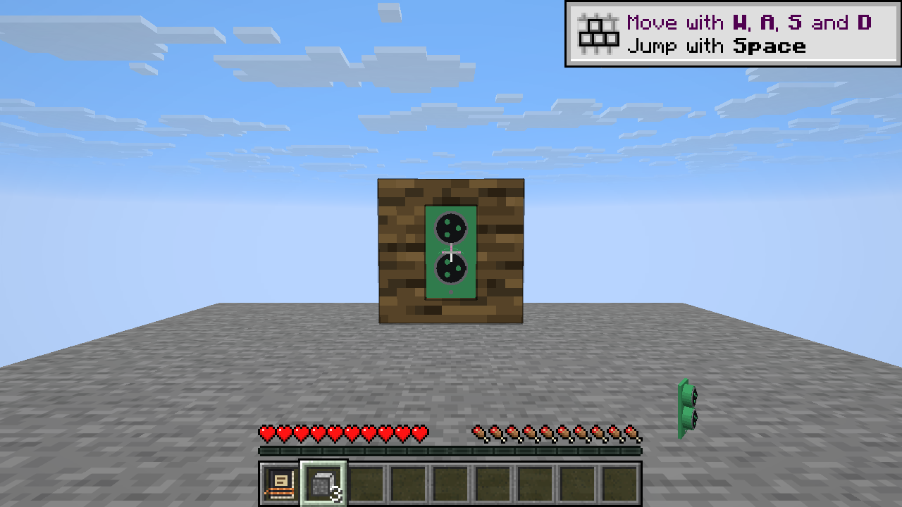
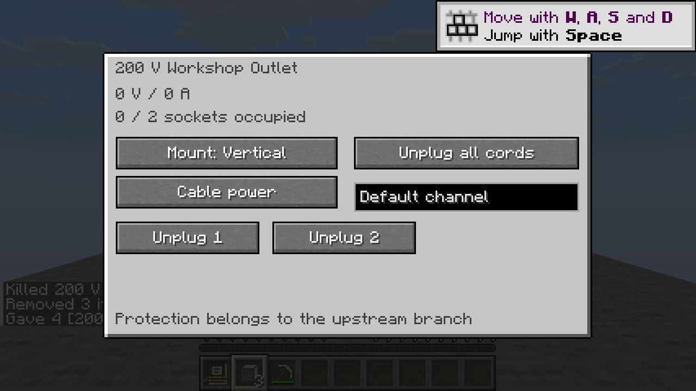
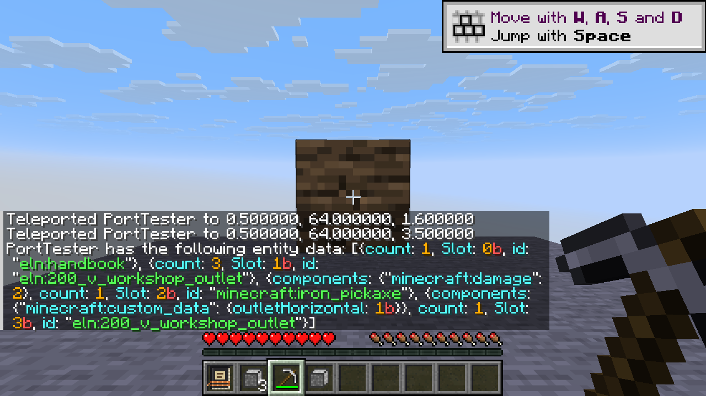

# Recessed wall outlets

Continuation of PR #1 from `b033290c1de4cef6ae11c97bbeb4071c87220b28`,
using ForkPatch 3.0.77 at `b7444a7b8a0c5e072b1fd35eed2b74a282c3348c`.
This is a development checkpoint; the remaining fork port is still in progress.

## Placement and ownership

A non-strip outlet clicked onto a horizontal face of a solid-render wall with
no block entity and no fluid replaces that wall cell. Surface placement remains
available through the existing path, and strips retain their surface-only policy.
The front cell stays free for another appliance.

The native item checks interaction/use permission on the actual wall cell,
verifies there is no resident node, then prepares the proposed block without
neighbor notification. NeoForge's real placement event can cancel it. Cancellation
restores the original state, unregisters the temporary node and consumes nothing.
If a callback takes ownership of the cell, rollback preserves that replacement.
Only a completed server transaction consumes the held item, once in survival and
never in creative. Unrelated held custom data remains intact.

The full original block state, including properties, is stored under `outletWall`
in the owner's saved node. It is never accepted from picked/configuration items.
Invalid saved wall states reject owner loading rather than silently replacing
unknown data. This is native save support, not a 1.21.1 world converter.

Player removal restores the original wall and applies native survival/creative
outlet-drop policy. Explicit physical destruction and explosion restore it without
minting another outlet. Known paid downstream cords disconnect and refund once.
Device drops use the exposed face so the restored solid wall cannot trap them.
Ordinary replacement with another block keeps that replacement; stale owners must
not resurrect their original wall over somebody else's block. Removal rechecks
cell and node ownership after drop callbacks, and `NodeManager.removeNode` removes
only the requested resident object instead of unregistering a fresh replacement.

## Native power topology

Recessed terminals meet centered electrical cables on the outside wall face,
one cell in front and one lateral cell from the saved owner. The explicit native
adapter selects actual legacy cable elements or voxel cable conductors and
registers passive electrical components in an ordinary `NodeConnection`, shared
by both ends. No current comes from a nominal-voltage substitute.

Connecting from either endpoint supports either placement order. Exact endpoint
identity prevents duplicate parallel links, and unchanged reconnect checks preserve
cached LU factors. Voxel ports require a real electrical cable boundary midpoint;
non-cable device pins, thermal wires, buses and unrelated offset devices are not
substituted. Resident-node lookup does not request chunks. Alternate wireless mode
removes these real wired links and ordinary mode rebuilds them.

Normal front/wrapped node matching cannot use a recessed outlet as a phantom
power connection to an appliance in front. That appliance still needs its own
paid cord. Reconnect scans skip non-electrical mounting faces.

## Geometry, light and rendering

`recessed`, facing and horizontal orientation are replicated block-state
properties. Collision and occlusion queries use that immutable state, including a
full original wall cell and the protruding faceplate; they never consult a block
entity, node map or neighboring chunk on worker threads. Opaque walls block
skylight. Original light emission is copied into native concurrent light state
and cleared on teardown. The client samples exposed-face light rather than the
dark interior of the opaque owner cell; a real Vulkan client exposed this issue,
and both native daylight assertions and before/after screenshots cover the fix.

Publication retains the complete original wall state. The faceplate/plug meshes
move to the outside face. Cord anchors and client endpoints carry an explicit
recessed flag; strips cannot claim that topology and cabinet anchors remain
unsupported. Rotation still republishes connected endpoints without paid work.

The original wall is a native block-model submission through `GlSubmit`, not an
old tessellator call. Resolved models are cached in a bounded 128-state cache and
invalidated after the native model resource-reload listener. Headless mesh tests
validate publication and submission data; actual visible-client results are
recorded separately in the validation evidence.

The outlet menu is a compact 300×176 control-only panel. Its zero-input owner
needs no inventory grid; all socket actions, mounting, wireless mode and channel
controls now fit the minimum 320×240 scaled viewport. Removing the grid changes no refund ownership or selected-unplug behavior. A real 720p automatic-scale client exposed
the older tall panel's clipping.

## Regression and session record

- Added real survival placement/property/geometry tests in every horizontal
  orientation, denied target permission, native event cancellation and foreign
  callback replacement.
- Added real legacy/voxel wire power checks in all four orientations and both
  placement orders, duplicate-link/LU guards and wireless-mode teardown/restore.
- Added actual owner reload with occupied socket/token, single refunds, creative,
  survival, physical, explosion and replacement removal policies.
- Added drop-callback replacement/stale-owner removal checks and exposed-face
  device-drop positions without changing the one-item accounting assertions.
- Added front-cell appliance tests with and without actual paid cord interaction,
  original light cleanup and immutable collision/light queries against a hostile
  world view that throws on block/entity/fluid access.
- Added strict recessed anchor round-trip/plane tests and rejection of impossible
  strip/cabinet/socket combinations.
- Preserved source baseline, native registry IDs, source manufacturing and solver
  infrastructure, existing expected goldens and build pins.

[Validation evidence](recessed-validation.json) records completed commands,
actual counts, artifact checks and remaining limitations. Initial test failures
identified light occlusion properties and fixture support/permission assumptions;
those were corrected without weakening the electrical or persistence checks.

## Visible client checks

The local display uses verified Debian Mesa software Vulkan (llvmpipe), with
NeoForge's optional early OpenGL window disabled in ignored local configuration.
No graphics capability values or artifact verification were bypassed. A copied
development world was used, not a user save.

Actual survival placement reduced the held stack from four to three. The original
oak-log wall and its orientation rendered after a separate client/JVM restart,
mount rotation worked, and an F3+T resource reload retained the wall/outlet models.
The opaque-cell lighting issue and the 720p automatic-scale menu clipping were
found in this client pass and fixed. Survival pickaxe removal restored the original
wall; approaching from the exposed face recovered one returned outlet. The actual
inventory report contains three original outlets plus one return with only
`outletHorizontal`, and no `outletWall` data.

These establish one local software-rendered client and its integrated server.
They do not establish hardware OpenGL/Vulkan, multiplayer, audio or every tinted
wall/resource-pack combination. Unfiltered server and root validation remain
separate from the client observations.

## Remaining work

Portable carry, compact plug-in UPS, further rated consumers, generalized panel
channels and source-world conversion remain on the [backlog](remaining-work.md).
Visual/headless checks do not by themselves establish hardware GPU, all resource
packs, multiplayer, audio or whole-mod performance parity.
